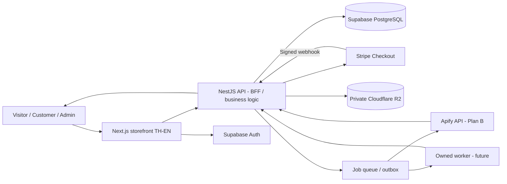

# Architecture and integration boundaries

**Design intent, not a claim of deployed infrastructure.** Next.js is UI/SSR; NestJS is the primary business backend. Supabase provides PostgreSQL and Auth. Cloudflare R2 stores private commercial artifacts. Stripe handles payments. Apify Actors/own workers execute cloud jobs.

## Runtime isolation
1. **Public web:** read-only public catalog; SSR localized `/th` `/en`, product JSON-LD when factual, guides and free tools; never expose provider keys.
2. **Frontend session:** Supabase Auth issued token; Next server-side auth middleware / SSR reads session. Client cannot mutate orders/entitlements by itself.
3. **Business API:** validates authenticated role and purchased privileges. Product/admin endpoints, Stripe sessions, webhooks, R2 signed delivery, automation jobs and usage ledger.
4. **Database:** Postgres constraints, indexes, RLS grants with tests. Service permissions used only in private servers.
5. **Files:** R2 objects in private bucket, no public bucket/list policy. DB points to object keys and checksum (never presigned URL persisted).
6. **Jobs:** transactional reservation of quota, idempotent execution request, separate worker callback and final charge settlement.

## API contracts (target)
| Method | Endpoint | Auth | Purpose |
|---|---|---|---|
| GET | /v1/catalog?locale=th | public | published products/categories |
| GET | /v1/catalog/:slug | public | details, versions and pricing |
| POST | /v1/checkout/sessions | customer | server-priced Stripe Checkout Session |
| POST | /v1/webhooks/stripe | Stripe signature | idempotent payment event processing |
| GET | /v1/me/library | customer | entitled products |
| POST | /v1/me/downloads/:artifactId | customer | authorize and sign GET URL |
| GET | /v1/me/orders | customer | own orders with provider status |
| POST | /v1/automations/:id/jobs | customer | validate input & quota, enqueue |
| GET | /v1/automations/jobs/:jobId | owner | polling results / failure |
| POST | /v1/admin/products | admin | create product draft |
| POST | /v1/admin/releases | admin | create release/upload manifest |

## Checkout event handling
- Price retrieved from DB server-side, with supported currency and tax policy determined by account.
- Store pending order with immutable line items, trusted product snapshots, idempotency key.
- Send customer to Stripe-hosted Checkout; use `client_reference_id` and metadata only as links, not truth.
- Verify raw webhook payload with Stripe signing secret; store event ID unique before state transition.
- Reconcile session/payment state and mark paid using a DB transaction/outbox, create entitlement once per order item.
- Handle asynchronous payment methods, failed payment, refunds/chargebacks and entitlement revocation separately.
- The redirect success URL only shows processing/confirmed order state by querying your backend.

## Download protocol
`GET /me/library → POST /me/downloads/:artifactId → auth + paid entitlement + release eligibility + download policy → server generates R2 GET presigned URL for 30–120s → client downloads → audit`. Signed URLs are bearer capabilities: do not leak in logs or analytics.

## Automation billing model
**Plan A:** users pay Apify directly according to its current eligible billing logic; owned store is documentation/marketing, not the billing processor.

**Plan B:** user pays own platform via Stripe for credits or subscription; backend reserves credits, invokes Apify API using your server token, records actual cost and exactly-once usage ledger settlement. Confirm API resale and upstream license terms; do not silently mark every job as paid.

**Hybrid:** both channels coexist. Do not transfer Apify customer identities or billing credentials without authorization. Migration opt-in only; keep distinct channel attribution.

## Hosting decision
Use R2 regardless of frontend hosting. Deploying Next.js to Cloudflare runtime requires testing exact supported Next features and business API isolation. If unsupported, use Node-capable deployment for Next and keep Cloudflare for CDN/DNS/R2. No production target is assumed in the static demo.

## Security / operations
CSP, CSRF/Origin checks when cookie auth is used, request rate limits, per-tenant quotas, malware scanning for uploaded files, audit trails, PII retention rules, worker retry dead-letter queue, event replay protection, backups, access revocation and alarm on costs.

## Sources
- https://docs.stripe.com/checkout/fulfillment
- https://docs.stripe.com/webhooks/signature
- https://supabase.com/docs/guides/database/postgres/row-level-security
- https://developers.cloudflare.com/r2/api/s3/presigned-urls/
- https://docs.apify.com/api/v2
