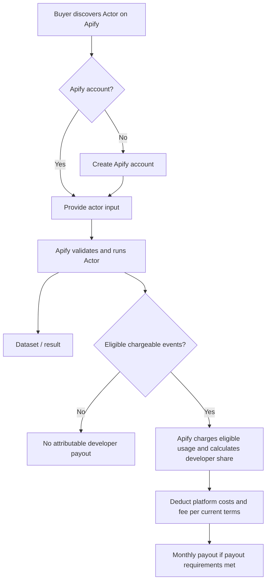
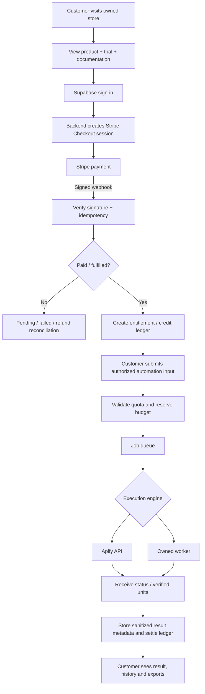
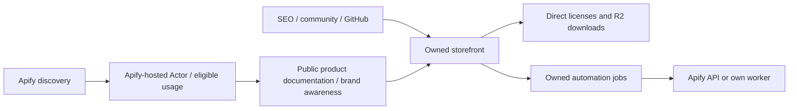
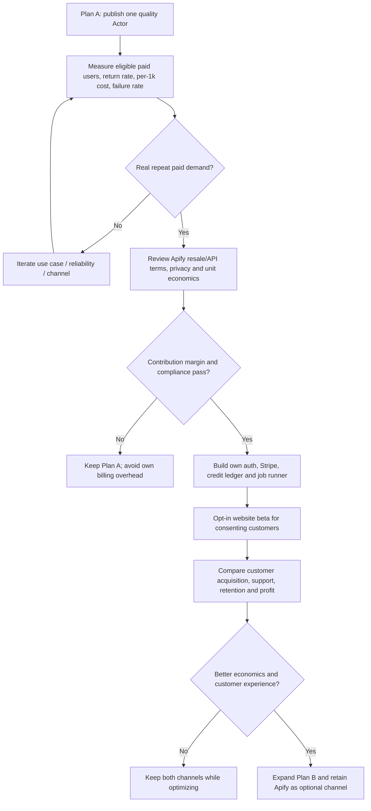

# Workflow diagrams: Plan A, Plan B, Hybrid and migration

These diagrams deliberately distinguish **actual payments** from **demo screens**. They are design specifications, not implemented integrations.

## Plan A — Apify Marketplace

Actor listing and running are hosted by Apify. An Apify free user is not automatically a paying customer. Confirm current pay-per-event fee and payout terms at launch; do not represent all Runs or all Dataset rows as payable Results.

## Plan B — owned website using Stripe and Apify/own worker

## Plan C — hybrid coexistence

Do not imply Apify customer identity, usage details or contact information can be exported or cross-sold without permission and platform terms.

## A → B transition (go/no-go gates)

## Purchase + download security state machine

`draft → pending_payment → paid → fulfilled` or `pending_payment → failed/canceled`; `paid → refunded/chargeback → entitlement revoked or reviewed`, depending on disclosed license policy.

No entitlement may be granted by visiting `/success` or manipulating localStorage. Signed R2 URL only after `session auth → entitlement → valid release → audit → signed GET`.

## SlipGuard verification model

`uploaded → OCR/QR extracted → external verification attempted → Verified / Suspicious / Duplicate / Unverified`, with reason codes and limited PII. Do not label a slip definitively fake solely from image analysis.
