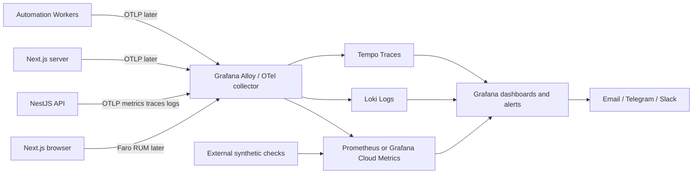

# BuildNest — Observability / Grafana Implementation Specification

**Status:** Proposed only / no integration enabled / no secrets used  
**Date:** 2026-10-29  
**Project reference:** BuildNest v0.3.1 QA package.  
**Restriction:** Keep approved M1.1 UX/UI pixel-stable. Observability dashboard is external Grafana, not a redesign of BuildNest. Do not use corporate computer or internal company systems. No production account/API keys.

## 1. Goals and acceptance criteria

- Every NestJS HTTP route is captured by global auto-instrumentation, not manually enumerated route by route.
- Key signals **RED** (Rate, Errors, Duration) by **route template**, HTTP method, environment and service, plus p50/p95/p99, request count, 4xx, 5xx, dependency durations, and trace correlation.
- Background job and payment lifecycle instrumented as named **business events** after future functionality exists. Monitoring MUST NOT claim that Stripe/R2/Apify are connected yet.
- An externally sourced health check is added for uptime when endpoints are deployed. Health checks must use dedicated endpoints and must not trigger paid actions.
- Database latency, slow queries and connection errors visible without logging user data or SQL bind parameters.
- Trace IDs embedded in structured JSON logs and surfaced through Grafana Explore.
- PII and secrets never appear in logs, labels or spans (email/phone/receipt images, Stripe keys, cookies, JWT, access tokens, SQL bindings, R2 signed URLs).
- Unit and smoke tests define monitoring behavior and alert rules; true Grafana validation remains gated until hosting and an OTel collector are available.

## 2. Architecture

**Grafana is the visualization/alerting layer, not the sole data collector.** Grafana Alloy is a compatible collector for OpenTelemetry/Prometheus signals; storage can be hosted Grafana Cloud or a self-hosted Prometheus+Loki+Tempo stack. For a small initial project, hosted Grafana Cloud can reduce management burden, subject to plan limitations and costs.

## 3. Existing API inventory to instrument

These are existing controller groups discovered in the code tree; exact routes must be determined by running endpoint registry or inspecting controller decorators at integration time.

| Area | Module currently present | Monitoring | Business readiness |
| --- | --- | --- | --- |
| Health | health.controller.ts | Uptime, probe reachability, health request latency | Endpoint exists; external probe not set up |
| Catalog | catalog.controller.ts | GET throughput, p95, cache vs DB, DB errors | Sample/live data modes vary |
| Identity | identity.controller.ts | Login/refresh/logout errors, authentication rejection trends; never log tokens | Integration code; credentials not connected |
| Admin | admin.controller.ts | 403/401/5xx, write latency, Audit Log failures | Protected write code; DB not connected |
| Automation | automation.controller.ts | Submission acceptance, run count, job queue, retries, durations, fail/timeout | Demo/mock only |
| Future Stripe | Not implemented | Webhook verification failures, duplicate callbacks, order transitions | Not connected |
| Future Cloudflare R2 | Not implemented | Signed URL issuance, permission denied, object retrieval errors | Not connected |
| Future Apify | Not implemented | Actor run latency, status, cost/event, retries and external errors | Not connected |

## 4. Metrics and labels — initial proposal

Use **OpenTelemetry HTTP semantic conventions** and verify actual exported names in Prometheus before importing dashboards. Illustrative Prometheus-converted series:

- `http_server_request_duration_seconds_count` — total HTTP operations.
- `http_server_request_duration_seconds_bucket` — histogram bucket of time.
- `http_server_request_duration_seconds_sum` — cumulative duration.
- Route dimensions: `http_route` (e.g. `/api/products/{id}`), `http_request_method`, `http_response_status_code`, `service_name`, `deployment_environment`.
- For downstream requests: client span `http.client`, network attributes and service/dependency name; avoid raw full URL labels containing query strings.
- Business signals when features exist: `buildnest_automation_jobs_total{status,tool}`, `buildnest_automation_job_duration_seconds`, `buildnest_checkout_events_total{stage}`, `buildnest_download_denied_total{reason}`.

**Cardinality control:** never use raw URLs with IDs, customer IDs, IPs, user names, request IDs or transaction IDs as metric labels. Put request and trace IDs only into bounded structured logs/traces with access policies. Label counts must be bounded, and sampling/retention must be cost-controlled.

## 5. Required dashboard pages

1. **Platform Overview**: health summary, request rate, 5xx %, p95, top failure endpoints, dependency health.
2. **API Endpoint Explorer**: per-route request counts, p50/p95/p99, 4xx/5xx; click through from metric to trace to log.
3. **Database and Dependencies**: Supabase Postgres/query duration and errors; Apify calls, Stripe webhook pipeline, R2 object errors once integrated.
4. **Automation Jobs**: created/succeeded/failed/retried/timeout, queue depth, execution duration, cost per run/event.
5. **Security & Authentication**: 401/403 trends, rate limits, rejected requests, abnormal failure surges — no credentials or raw payloads.
6. **Frontend Experience (later)**: Grafana Faro browser errors and Web Vitals, Next.js server traced separately.

## 6. Illustrative alerting policy (adjust after baseline)

| Name | Trigger / evaluation example | Priority | Notes |
| --- | --- | --- | --- |
| External site down | external `probe_success == 0` continuously for 5 minutes | P1 | Only post-deployment; verify from external vantage point |
| API high server errors | 5xx ratio >5% for 5 minutes **and** >=20 requests in the window | P1/P2 | Avoid tiny-sample false positives |
| Latency regression | p95 >2 seconds for 10 minutes with meaningful traffic | P2 | Per route/SLO; adapt by endpoint class |
| Admin auth anomaly | 401/403 rejection volume significantly above baseline | P2 | Investigation, not definitive evidence of attack |
| Payment webhook backlog | pending/failed verified webhook processing > threshold | P1 | Future only; must never log payload/token |
| Worker stuck | no heartbeats / oldest queued age > threshold | P2 | Future only; ensure queue metrics exist |
| Collector scrape missing | no fresh telemetry and external monitor still up | P2 | Separately distinguish observation failure from service failure |

Grafana Alerting contact points can route to email, Telegram, LINE, Slack, etc. Use real channels only after the user approves and configures them.

## 7. Error-to-root-cause workflow

1. Alert fires for a failing or slow **route template**.
2. Grafana panel shows Rate/Errors/Duration for service, environment, method and route.
3. Open trace exemplar / corresponding trace in Tempo to see controller, DB and external-API spans.
4. Correlate structured log by `trace_id` in Loki (sanitized fields only).
5. Determine whether issue is application bug, database bottleneck, third-party timeout, capacity saturation or network reachability.
6. Fix + add regression test; run controlled smoke/load tests; verify metrics return to baseline.

## 8. Proposed staged rollout

**Stage OBS-0 — now (no external services)**
- Approve instrumentation plan, panel templates and tests. Keep M1.1 UI frozen.
- No backend modification, secrets, installation on corporate PC or access to company resources.

**Stage OBS-1 — on personal development environment**
- Install workspace deps, establish `npm run build` baseline and local NestJS API.
- Add OpenTelemetry Node.js and NestJS instrumentation in an early bootstrap module.
- Implement a non-public/guarded metrics exposure strategy or OTel push to collector, per deployment architecture.
- Structured logs: trace ID and no sensitive payloads.
- Tests: middleware/metrics unit, failure cases, route-normalization, masked logging, failure counters.

**Stage OBS-2 — isolated staging**
- Connect Grafana Cloud or private Docker Compose with Alloy + Prometheus + Loki + Tempo + Grafana; link datasources and import dashboard.
- Run deliberate synthetic test failures: 500, 429, 401, timeouts, DB delay, worker failure and alert recovery.
- Validate time series counts and labels; visual regression for storefront remains unchanged.

**Stage OBS-3 — after backend/payment go live**
- Add business-level spans and metrics for Stripe/entitlements/R2/Apify.
- Add external synthetic checks, alerts, retention budgets, owner access controls and incident runbook.
- Keep the monitoring console separate from the public customer/admin UI (link only from authorized admin if desired).

## 9. Testing checklist (proposed, not run)

- [ ] Every route has nonzero request metric after one request.
- [ ] Known 2xx, 4xx and 5xx contribute to the correct status class.
- [ ] Thrown exceptions are counted once, with correct trace correlation.
- [ ] Dynamic `/products/abc` and `/products/xyz` roll into one route template, not two labels.
- [ ] No JWT, cookie, user email, PromptPay phone, Stripe key, signed download URL or receipt payload in telemetry.
- [ ] Client and server timings distinguish downstream dependency delays.
- [ ] Incoming traceparent is safely propagated; missing headers create valid new traces.
- [ ] Collector outage does not block request handling.
- [ ] Alert fires for synthetic service outage and resolves after recovery.
- [ ] Low-traffic 5xx never pages on an arbitrary one-request denominator.
- [ ] Grafana access restricted to authorized operators; dashboards/alerts versioned.
- [ ] Existing product/checkout/CSRF and Design Lock tests still pass.

## 10. Current blockers

- Full Next.js/NestJS production builds are not yet independently verified; npm dependencies not available in earlier QA runtime.
- No Grafana hosting/collector/data sources configured.
- No Supabase staging project, Stripe test account, R2 or Apify secrets authorized.
- Therefore dashboard JSON is an **import template** — it will show no live data until telemetry is connected and metric names are confirmed.

## Official references

- https://docs.nestjs.com/observability/opentelemetry
- https://grafana.com/docs/alloy/latest/introduction/how-alloy-works/
- https://grafana.com/docs/grafana-cloud/observe-and-act/testing/synthetic-monitoring/introduction/
- https://grafana.com/docs/grafana/latest/alerting/fundamentals/notifications/contact-points/
- https://grafana.com/docs/grafana-cloud/observe-and-act/monitor-applications/frontend-observability/get-started/instrument-nextjs/
- https://opentelemetry.io/docs/specs/semconv/http/http-metrics/
